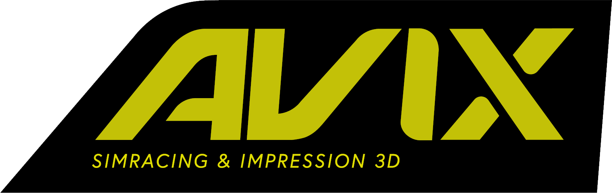

  

<h1 align="center">AVIX LMU Dash Switcher</h1>

  Plugin <b>SimHub</b> pour <b>Le Mans Ultimate</b> : le bon dashboard pour chaque voiture, sur tous tes écrans. 
  <b>v1.4.0</b> · par <a href="https://avix3d.com">AVIX 3D</a>

---

## Fonctionnalités

- **Changement automatique du dashboard** selon la voiture pilotée (Ferrari 499P → dash 499P, BMW M4 GT3 → dash M4…).
- **Un seul dashboard, « AVIX LMU Auto »**, qui contient toutes les voitures : tu le mets sur tous tes écrans, il affiche
  le dash de la voiture en cours. Hors LMU : écran d'attente AVIX.
- **Tactile VoCore** : moitié gauche de l'écran = page précédente, moitié droite = page suivante.
- **Adaptation au format de l'écran** (VoCore 7,85" 1280 × 400 par défaut) : les blocs sont écartés pour remplir
  la largeur, sans rien déformer. Autres formats disponibles dans la page du plugin.
- **Polices** copiées dans `SimHub\DashFonts` et installées dans Windows.
- Page de réglages au style avix3d.com : voiture détectée, règles voiture → dashboard, écrans pilotés.

## Installation

1. **Télécharge** la dernière version dans [**Releases**](../../releases) (ou **Code → Download ZIP**) et dézippe.
2. *(Optionnel)* Mets tes dashboards `.simhubdash` dans `Plugin/AvixLmuDash/Dashboards`
   et leurs polices dans `Plugin/AvixLmuDash/Fonts`.
3. Lance **`AvixInstaller.exe`** : il ferme SimHub, copie le plugin, installe polices et dashboards, puis relance SimHub.
4. Au démarrage, SimHub propose d'activer le nouveau plugin : réponds **Oui**.
5. Menu de gauche **AVIX LMU Dash** → bouton **« Mettre « AVIX LMU Auto » sur mes écrans + activer le tactile »**.

> Installation manuelle : copie `Plugin/AvixLmuDashSwitcher.dll` **et** le dossier `Plugin/AvixLmuDash`
> dans le dossier de SimHub (`C:\Program Files (x86)\SimHub`), puis lance SimHub.

## Comment ça marche

Dans LMU, l'« ID voiture » de SimHub est le nom de la livrée (ex. `GT3_Akkodis ASP Team 2026_78`), pas le modèle :
la playlist par voiture de SimHub ne suffit donc pas. Le plugin lit le **vrai modèle** dans la télémétrie native de LMU
(`mVehicleModel`) et la **classe** (Hypercar / LMP2 / LMP3 / GTE / GT3), puis applique ses règles. Si le modèle n'est
pas disponible, il se rabat sur des mots-clés d'équipe (AF Corse → Ferrari, Akkodis → Lexus, Manthey → Porsche…).

Une voiture tombe sur le mauvais dash ? Dans la page du plugin, choisis le bon dashboard puis
**« Utiliser ce dash pour cette voiture »** : une règle est ajoutée.

## Dashboards attendus par les règles par défaut

Nom du dossier dans `SimHub\DashTemplates` :

| Classe | Dashboards |
|---|---|
| Hypercar | Ferrari 499P - V2.0 · Toyota GR010 Hybrid · HY Porsche 963 LMDh · HY BMW Hybrid V8 new version · Cadillac V-Series - LMU · Peugeot 9X8 · Alpine A424 LMDh · Lamborghini SC63 · Isotta Fraschini Tipo 6 LMH · Glickenhaus · Vanwall 680 · HY Aston Martin Valkyrie LMH · HY Genesis GMR-001 |
| LMGTE | Ferrari 488GTE · Corvette C8.R - LMU · Aston Martin Vantage GTE - LMU · Porsche 911 RSR |
| LMGT3 | LMGT3 BMW M4 · LMGT3 Ferrari 296 · LMGT3 Porsche 911 GT3 R - standard size DDU · LMGT3 Lexus RC F GT3 · LMGT3 McLaren 720S · LMGT3 Mercedes AMG GT3 · LMGT3 Chevrolet Corvette Z06 · LMGT3 Lamborghini Huracan GT3 Evo 2 · LMGT3 Aston Martin |
| LMP2 | LMP2 LMU |
| LMP3 | LMP3 Ginetta G61 · LMP3 Ligier JS P325.simhubdash |

Les dashboards ne sont pas inclus dans ce dépôt (dashboards d'autres auteurs).

## Propriétés SimHub

| Propriété | Contenu |
|---|---|
| `AvixLmuDashPlugin.VehicleModel` | modèle détecté |
| `AvixLmuDashPlugin.CarClass` | classe (HYPER, GT3…) |
| `AvixLmuDashPlugin.Dashboard` | dashboard choisi |
| `AvixLmuDashPlugin.MasterSlot` | dashboard affiché dans « AVIX LMU Auto » |
| `AvixLmuDashPlugin.Status` | état du plugin |

Action mappable sur un bouton : `AvixLmuDashPlugin.ReapplyDashboard`.

Le workflow **Release** crée automatiquement le zip prêt à installer dans l'onglet Releases.

## Désinstaller

Supprime `AvixLmuDashSwitcher.dll`, le dossier `AvixLmuDash` et le dashboard `DashTemplates\AVIX LMU Auto`
dans le dossier de SimHub.
